<div align="center">



<br>

[](LICENSE)
[](https://www.rust-lang.org/)
[](https://tauri.app/)
[](#-deploy)

<br>

*Tenno. The Void hides what every reward is worth.*<br>
*FrameSight reads it for you, and never touches the game.*

</div>

<br>


## ◈ Arsenal

<table>
<tr>
<td width="50%" valign="top">

### ◇ Void Fissure rewards

Platinum and ducats under each reward card the moment the screen opens. FrameSight sees
the reward arrive in `EE.log`, reads the cards with Tesseract and prices the whole squad's
relic pool from sellers who are in game right now. With Full access it also marks what you
own, what you are missing and what you still need for mastery.

</td>
<td width="50%" valign="top">


</td>
</tr>
<tr>
<td width="50%" valign="top">


</td>
<td width="50%" valign="top">

### ◇ Baro Ki'Teer's Ducat Kiosk

Before trading a Prime part for ducats, see what it is worth in platinum. Every tile gets a
platinum figure, each pick lands in a sell list, and the list totals itself as it fills.
With Full access, parts of gear you have not mastered or built read **Unmastered**.

</td>
</tr>
<tr>
<td width="50%" valign="top">

### ◇ Collection & mastery

Gear, Prime parts, relics, resources, blueprints, mods and arcanes on one screen. Search,
filter to owned, mastered or missing, and sort by platinum or ducats. Prices come from a
daily warframe.market summary served by relics.run, mods and arcanes at their actual rank.

</td>
<td width="50%" valign="top">


</td>
</tr>
<tr>
<td width="50%" valign="top">


</td>
<td width="50%" valign="top">

### ◇ warframe.market

Link your account only if you want to. FrameSight flags listings for items you no longer
own or that oversell what you hold, and lets you list, delist and change your online
status without leaving the app.

</td>
</tr>
</table>


## ◈ Access levels

You choose what FrameSight may touch, before it observes Warframe. Nothing starts until you
confirm, and lowering the level retires everything it no longer permits.

| | Level | Reads | For |
| :---: | --- | --- | --- |
| ◇ | **Companion** | Nothing from the game | Collection snapshot, prices, market orders |
| ◈ | **Overlay** | The screen and `EE.log` | Reward overlay, Ducat Kiosk overlay |
| ◆ | **Full** | An account ID and nonce from the Warframe process | Automatic inventory sync, ownership and mastery marks |

> [!IMPORTANT]
> Full sends that account ID and nonce to `mobile.warframe.com`'s inventory endpoint and
> nowhere else. Overlay never reads process memory. No level writes to the game, automates
> input or sends telemetry.


## ◈ Deploy

Download the [latest release](https://github.com/jawsbb/FrameSight/releases/latest): the
Windows installer, the AppImage, or the `.deb` and `.rpm` packages. The app offers its own
updates. On Linux the overlays also need `tesseract` with its English data; the Windows
installer carries its own. Per-system details are in the [install guide](docs/install.md).

To build from source instead:

```bash
corepack enable
cd app && pnpm install --frozen-lockfile
pnpm tauri dev
```

You need Rust (pinned in [`rust-toolchain.toml`](rust-toolchain.toml)), Node with pnpm and the
Tauri 2 system libraries; see [`packaging/`](packaging/README.md).

- **Windows:** play Warframe in Borderless mode; exclusive fullscreen hides the overlay.
- **Linux:** Warframe runs through Wine or Proton. Wine virtual-desktop mode also needs `xwininfo`.
- **Language:** the screen readers read a game running in English or French; other languages are not read.


## ◈ Origins

FrameSight continues [TennoScope](https://github.com/Deftera186/tennoscope), created by
Deftera186 and its contributors. A TennoScope install's collection, settings and market link
carry over on FrameSight's first launch.

<div align="center">

<br>

[Install guide](docs/install.md) ◇ [Docs](docs/README.md) ◇ [Contributing](CONTRIBUTING.md) ◇ [Changelog](CHANGELOG.md) ◇ [Security](SECURITY.md)

<br>

<sub>[GPL-3.0-only](LICENSE). FrameSight is an unofficial fan project, not affiliated with or endorsed by Digital Extremes.<br>
Warframe and its artwork belong to Digital Extremes; see [THIRD_PARTY_NOTICES.md](THIRD_PARTY_NOTICES.md).</sub>

</div>
